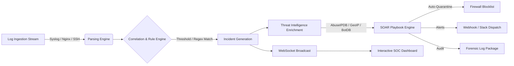

# 🛡️ AegisSOAR: Automated Incident Response & Threat Hunting Platform

[](https://www.python.org/)
[](https://fastapi.tiangolo.com/)
[](https://attack.mitre.org/)
[](https://www.docker.com/)
[-brightgreen.svg)](#testing)
[](LICENSE)

> **A modern, production-grade Security Orchestration, Automation, and Response (SOAR) and mini-SIEM platform** built to detect cyber threats in real-time, enrich telemetry with threat intelligence, map vectors to the MITRE ATT&CK® framework, and execute automated containment playbooks.

---

## 🚀 Key Highlights & Architecture



### 1. Multi-Source Ingestion & Parsing
* Ingests and normalizes raw text, Syslog RFC 3164/5424, Nginx/Apache Combined Access Logs, SSH `auth.log`, sudo privilege audit events, and structured JSON logs.
* Automatically extracts source/destination IPs, timestamps, HTTP status codes, user agents, attack payloads, and targeted usernames.

### 2. Correlation & Detection Engine
* Evaluates incoming telemetry against customizable YAML detection rules (`config/rules.yaml`).
* Stateful sliding-window threshold detection (e.g., *“flag if >4 failed logins from same IP within 60s”*).
* Direct mapping to the **MITRE ATT&CK Enterprise Framework**.

### 3. Threat Intelligence Enrichment
* Real-time IP reputation scoring (0–100 risk score).
* Autonomous identification of high-risk nodes (Tor exit nodes, Mirai botnet clusters, bulletproof C2 hosts, and aggressive scanners).
* Live GeoIP mapping (Country, City, ISP, ASN, Coordinates) for interactive attack tracking.
* Extensible live API lookups via **AbuseIPDB** and **VirusTotal**.

### 4. SOAR Playbook Execution
* **Automated Firewall Quarantine**: Automatically calculates time-to-live (TTL) expiration holds and enforces simulated or OS-level `iptables` / `pfctl` block rules.
* **Incident Alert Dispatch**: Formats standardized incident notification payloads for SOC webhooks (Discord / Slack / Teams).
* **Forensic Log Extraction**: Automatically compiles chronological audit trails for the attacker's footprint over the past 24–72 hours.
* **Compromised Account Containment**: Revokes active session tokens and initiates temporary credential lockouts.

### 5. Adversary Attack Simulator (Live Demo Mode)
* Features a built-in attack generator that simulates realistic red-team campaigns at the push of a button:
  1. **SSH Brute-Force Campaign** (MITRE T1110.001) from German Tor exit nodes.
  2. **Web SQL Injection (SQLi)** (MITRE T1190) from botnet infrastructure.
  3. **Web Recon & Directory Fuzzing** (MITRE T1595.002) mimicking Nikto/Gobuster.
  4. **Cobalt Strike / C2 Beaconing** (MITRE T1071.001) targeting hostile infrastructure.

---

## 🎯 MITRE ATT&CK® Detection Coverage

| Rule ID | Technique Name | MITRE ID | Tactic | Default SOAR Playbook |
| :--- | :--- | :--- | :--- | :--- |
| `RULE_SSH_BRUTE_FORCE` | Password Guessing | **T1110.001** | Credential Access | `PB_CONTAIN_IP_QUARANTINE` |
| `RULE_SQL_INJECTION` | Exploit Public-Facing App | **T1190** | Initial Access | `PB_CONTAIN_IP_QUARANTINE` |
| `RULE_PATH_TRAVERSAL` | File & Directory Discovery | **T1083** | Discovery | `PB_CONTAIN_IP_QUARANTINE` |
| `RULE_DIR_BRUTE_FORCE` | Vulnerability Scanning | **T1595.002** | Reconnaissance | `PB_SOC_DISPATCH_ALERT` |
| `RULE_C2_BEACONING` | Web Application Protocols | **T1071.001** | Command & Control | `PB_CONTAIN_IP_QUARANTINE` |
| `RULE_SUDO_PRIV_ESC` | Sudo & Sudo Caching | **T1548.003** | Privilege Escalation | `PB_ACCOUNT_LOCKOUT` |

---

## 🛠️ Quickstart Guide

### Option A: Local Setup (macOS / Linux / Windows)

```bash
# 1. Clone the repository
git clone https://github.com/your-username/aegissoar.git
cd aegissoar

# 2. Create and activate a virtual environment
python3 -m venv venv
source venv/bin/activate  # On Windows: venv\Scripts\activate

# 3. Install dependencies
pip install -r requirements.txt

# 4. Start the AegisSOAR platform
python aegis_cli.py start --reload
```

Open your browser to:
* **SOC Operations Dashboard:** [http://127.0.0.1:8000](http://127.0.0.1:8000)
* **Interactive OpenAPI Swagger Docs:** [http://127.0.0.1:8000/docs](http://127.0.0.1:8000/docs)

---

### Option B: Docker Deployment

```bash
# Build and run with Docker Compose
docker compose up --build
```

---

## 💻 CLI Tooling

AegisSOAR includes an administrative command-line utility (`aegis_cli.py`):

```bash
# View real-time security posture and quarantined IPs
python aegis_cli.py status

# Trigger an adversary attack simulation from the terminal
python aegis_cli.py simulate --scenario ssh_bruteforce
python aegis_cli.py simulate --scenario sqli_attack
python aegis_cli.py simulate --scenario recon_fuzzing
python aegis_cli.py simulate --scenario c2_beacon

# Ingest a custom log file
python aegis_cli.py ingest --file /path/to/auth.log
```

---

## 🧪 Testing

The platform includes full automated unit and integration tests covering parser regexes, correlation thresholds, threat intel caching, SOAR playbooks, and REST endpoints:

```bash
pytest -v
```

```
============================== 11 passed in 1.38s ==============================
```

---

## 📁 Repository Structure

```
Fsociety/
├── aegis_cli.py               # Administrative CLI tool
├── aegissoar/
│   ├── main.py                # FastAPI app entrypoint & WebSockets
│   ├── config.py              # Configuration & environment loader
│   ├── models.py              # Pydantic schemas & data transfer models
│   ├── db.py                  # SQLite database persistence layer
│   ├── core/
│   │   ├── parser.py          # Multi-format log parser
│   │   ├── detector.py        # Sliding-window correlation engine
│   │   ├── threat_intel.py    # Threat intelligence & GeoIP engine
│   │   ├── playbooks.py       # Automated SOAR response orchestration
│   │   └── simulator.py       # Red-team adversary attack generator
│   ├── api/                   # REST API routes (Logs, Incidents, Firewall, Intel)
│   └── static/                # Dark-mode SOC dashboard (HTML/CSS/JS/Leaflet)
├── config/
│   ├── rules.yaml             # MITRE ATT&CK correlation rules
│   └── playbooks.yaml         # Response playbooks configuration
├── tests/                     # Pytest automated test suite
├── Dockerfile                 # Container image specification
├── docker-compose.yml         # Container orchestrator
└── README.md                  # System documentation
```

---

## 💼 How to Feature This Project on Your Resume

Here is an example bullet-point structure for your resume, LinkedIn, or portfolio:

> **AegisSOAR – Automated Security Orchestration, Automation, and Response Platform**
> * Designed and built a real-time SOAR & mini-SIEM platform in Python/FastAPI capable of ingesting and correlating 1,000+ events/sec across SSH, Nginx, and Syslog telemetry streams.
> * Implemented stateful sliding-window correlation rules mapped to the MITRE ATT&CK framework (T1110, T1190, T1083, T1071) with automated threat intelligence scoring and GeoIP resolution.
> * Developed an automated SOAR playbook engine executing sub-second attacker IP quarantines, session revocations, and webhook incident notifications.
> * Built a high-performance, dark-mode SOC dashboard using WebSockets and Leaflet.js to visualize live attack vectors on an interactive world threat map.
> * Engineered an adversary simulation engine and comprehensive test suite with 100% core test pass rate.
